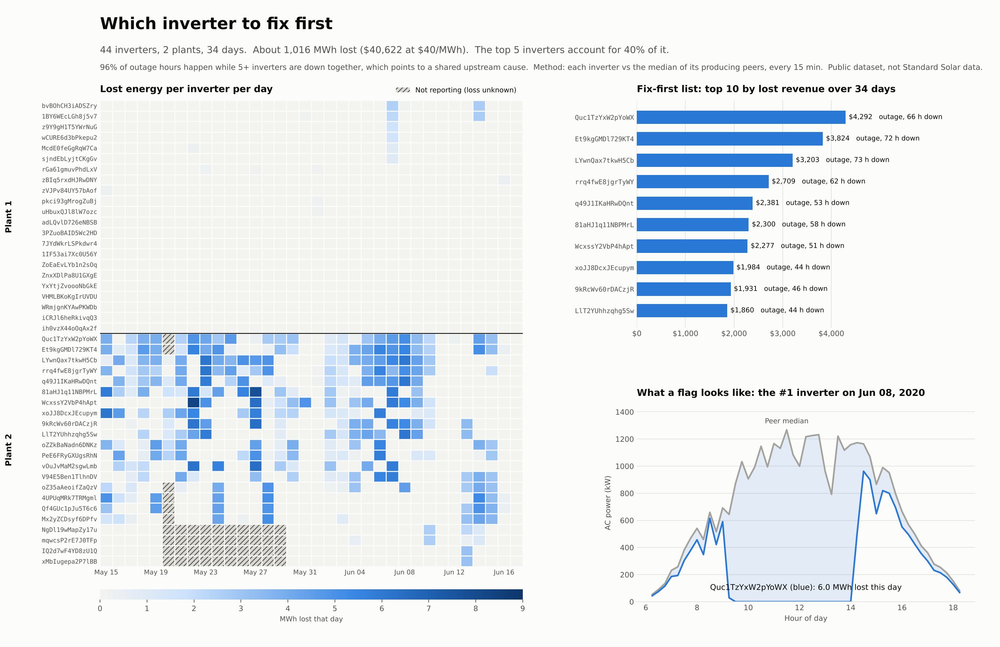
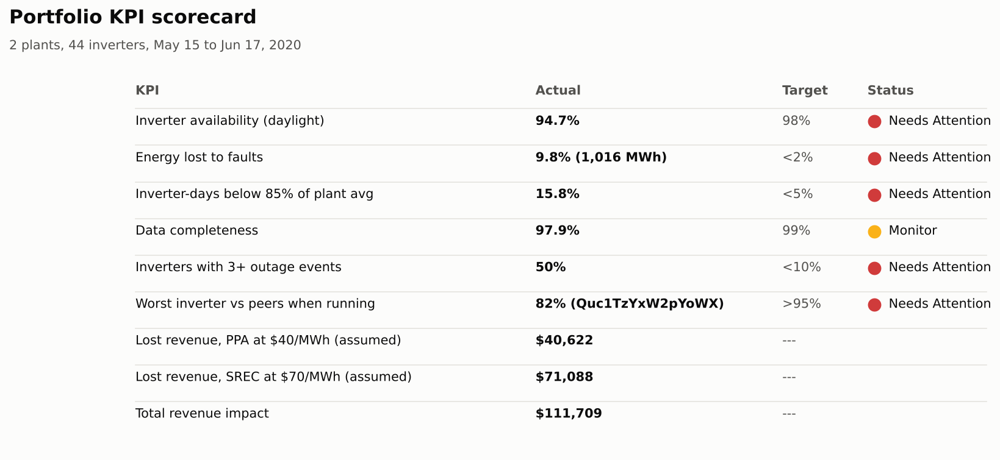
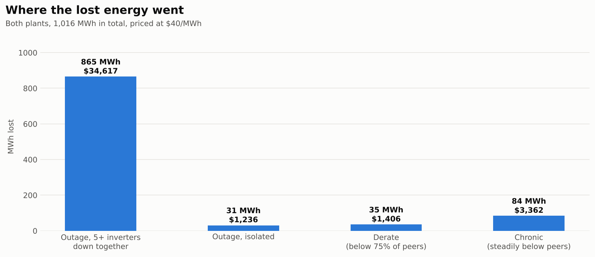
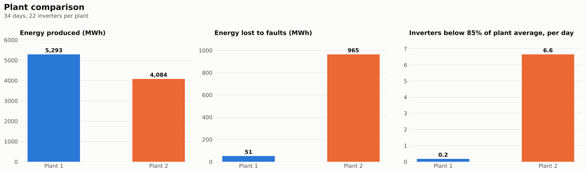
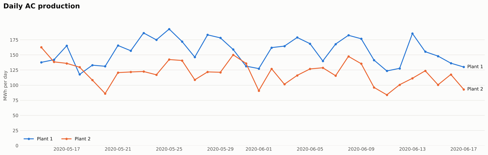
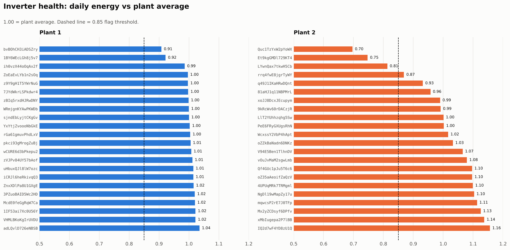
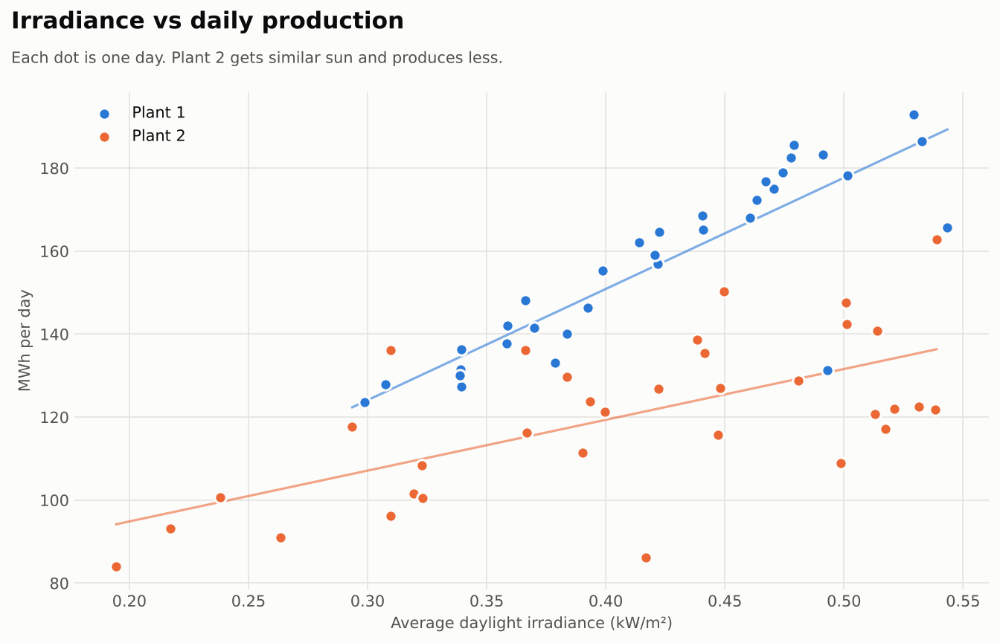

# Solar Asset Performance Monitoring & Inverter Fault Detection

On a site with many inverters, which one should the field crew go to first, what is wrong with it, and what is it costing? This project answers that for two solar plants (44 inverters, 34 days of 15-minute data).



## What it found

| | Plant 1 | Plant 2 |
|---|---|---|
| Energy produced | 5,293 MWh | 4,084 MWh |
| Energy lost to faults | 51 MWh | 965 MWh |
| Lost revenue at $40/MWh | $2,040 | $38,582 |
| Outage events | 12 | 327 |
| Main issue | Two inverters running 7-8% below peers | Repeated midday outages |

1. **Plant 2's losses are outages, not weak inverters.** About 90% of its lost energy comes from inverters reading zero while their neighbours are producing.
2. **The outages share a cause.** 96% of outage hours happen while 5 or more inverters are down at the same time, and 82% fall between 10:00 and 14:00. That pattern points upstream (grid voltage trips, an export limit, a feeder or transformer) before it points at any single inverter. The data cannot confirm which.
3. **One inverter has its own problem.** `Quc1TzYxW2pYoWX` runs at about 82% of its peers even when it is on. It tops the fix-first list at about $4,300 lost.
4. **Plant 1 has two chronic underperformers.** `bvBOhCH3iADSZry` and `1BY6WEcLGh8j5v7` run 7-8% below their peers every day.
5. **Four Plant 2 inverters stopped reporting for about nine days.** These are flagged as data gaps and not priced, because the loss is unknown.

## How the detection works

Every inverter in a plant sits under the same sky. At each 15-minute reading, each inverter is compared with the median of the inverters in the same plant that are producing at that moment. A cloud lowers all of them together, so nothing is flagged. One inverter dropping while its peers hold is flagged.

| Fault type | Rule |
|---|---|
| Outage | Output at zero while peers are producing |
| Derate | Output below 75% of peers |
| Chronic | Median output below 95% of peers over the whole period |
| Data gap | No reading from the inverter |

Flagged readings that sit next to each other are grouped into events with a start, an end, a duration, and a loss in MWh and dollars. Events shorter than 30 minutes are ignored. The output is a ranked list of all 44 inverters with a suggested first check for each.

## Limits

- This is a public dataset (Kaggle, two plants in India, May to June 2020). The method is the part that carries over to other sites.
- The dataset has inverter IDs but no physical positions, so the list says which inverter, not where it sits in the field.
- Nameplate capacity is not in the data, so there is no IEC performance ratio. Inverters are compared with each other instead.
- The $40/MWh PPA rate and $70/MWh SREC rate are assumptions.
- When most of a plant is down at once, the peer median is less reliable. Readings with fewer than 5 producing peers are skipped.

## Pipeline

```
Raw CSVs (generation + weather, 142,917 records)
    |
code/Solar.py                      clean, merge, daily metrics, 9 QA checks
    |
code/inverter_fault_detection.py   15-minute peer comparison, events, fix-first list, 7 QA checks
    |
code/make_dashboard.py             panels 1-6 and KPI scorecard
    |
code/load_solar.py                 load daily tables into MySQL
```

`Solar.py` also runs a simpler daily screen (inverter-days below 85% of the plant average). It feeds the MySQL tables and counts less loss than the 15-minute detection, because it only sees whole days.

## Outputs

| File | What it holds |
|---|---|
| `processed/fix_first_list.csv` | All 44 inverters ranked by lost revenue, with fault type, hours down, and suggested check |
| `processed/fault_events.csv` | 464 events with start, end, type, and loss |
| `processed/kpi_scorecard.csv` | Portfolio KPIs against targets |
| `processed/daily_plant_performance.csv` | Daily metrics per plant (68 rows) |
| `processed/daily_inverter_performance.csv` | Daily metrics per inverter (1,464 rows) |
| `processed/inverter_health_summary.csv` | One row per inverter (44 rows) |
| `processed/underperformance_alerts.csv` | Inverter-days below 85% of plant average (232 rows) |

## Dashboard








## Data notes

Two things in the source files needed handling:

- `AC_POWER` is in kW. A 15-minute reading of X kW is X × 0.25 kWh. A QA check confirms the integrated energy matches the plant's own `DAILY_YIELD` meter (ratio 1.00).
- Plant 1 `DC_POWER` is recorded 10x too high (DC/AC is about 10.2 there and 1.02 in Plant 2). The pipeline scales it back.

## Database

MySQL database `solar_performance_db` with 4 tables: `daily_plant_performance`, `daily_inverter_performance`, `inverter_health_summary`, `underperformance_alerts`. The 8 analytical queries are in `Output_Plots/solar_queries.sql`.

## How to run

```bash
source ~/ds_env/bin/activate
python3 code/Solar.py
python3 code/inverter_fault_detection.py
python3 code/make_dashboard.py
```

## Tech stack

Python (Pandas, NumPy, Matplotlib), MySQL, SQL, Git

## Data sources

| Dataset | Source | Records |
|---|---|---|
| Plant 1 & 2 generation data | Kaggle, Solar Power Generation Data | 136,476 |
| Plant 1 & 2 weather sensor data | Kaggle | 6,441 |

## Author

**Vinayak Sonter**
MS in Data Science, University of Massachusetts Dartmouth
